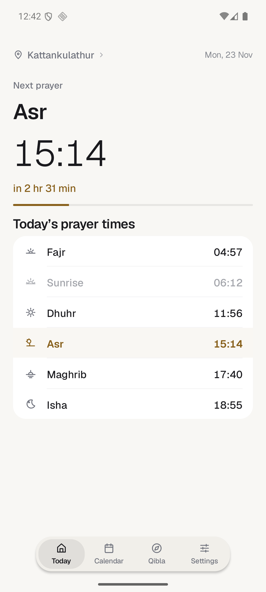
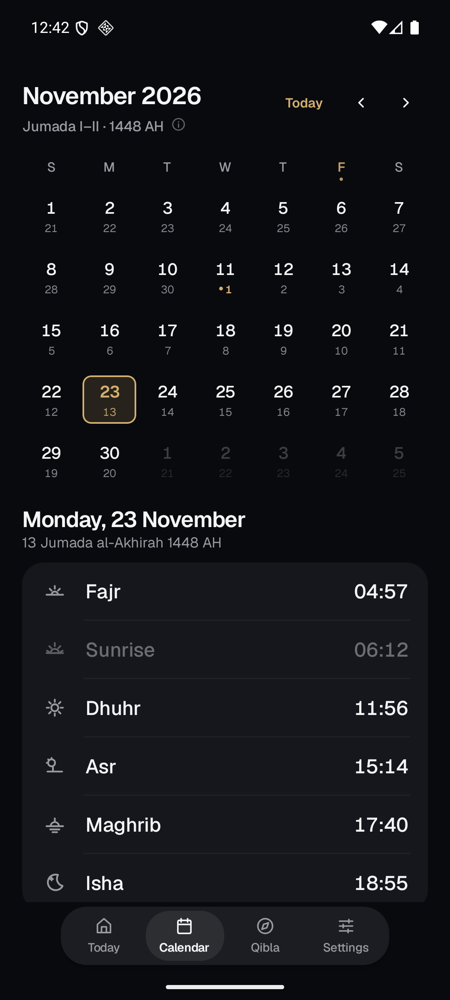
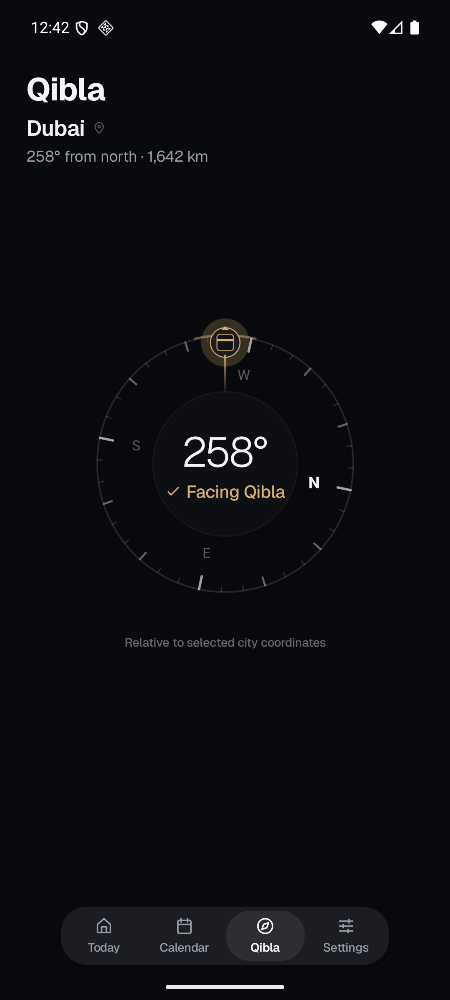
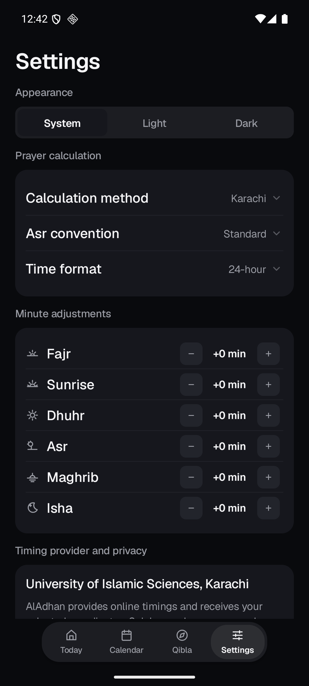
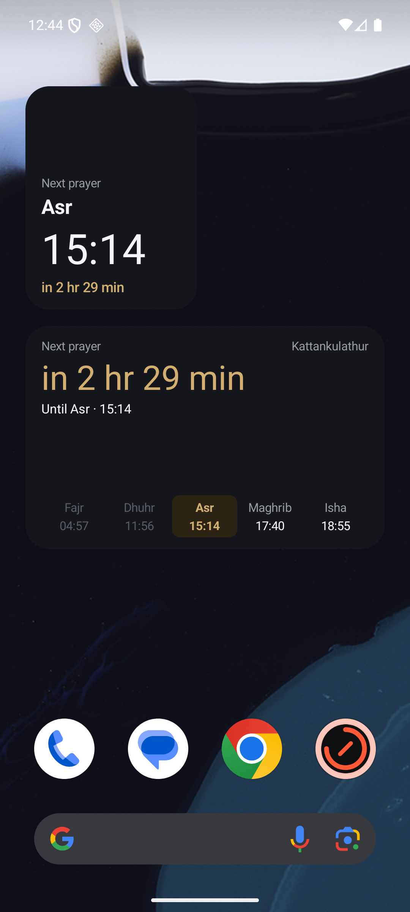

# Salah

A privacy-conscious, open-source Android prayer companion.

[](https://github.com/abbasahamed/salah-app/actions/workflows/ci.yml)
[](https://github.com/abbasahamed/salah-app/releases/latest)
[](LICENSE)
[](https://www.android.com/)
[](#privacy)

---

## Overview

Salah is a standalone native Android application providing accurate Islamic prayer times, an interactive Gregorian and Hijri calendar, sensor-driven Qibla direction, and Android home-screen widgets.

The project is built with Kotlin and Jetpack Compose around three core architectural tenets:
1. **Unconditional Privacy:** Zero accounts, zero registration, zero advertising, zero analytics SDKs, and zero telemetry.
2. **Offline-First Resilience:** Astronomical calculations, a global database of over 30,000 cities, and timezone spatial lookup operate directly on-device with zero network connectivity.
3. **Refined Native Design:** A bespoke editorial interface featuring Geist typography, purposeful micro-interactions, squarish calendar selections, custom prayer vectors, and balanced light and dark palettes.

---

## Screenshots

| Today (Dark) | Today (Light) | Calendar |
| :---: | :---: | :---: |
|  |  |  |

| Qibla Compass | Settings | Home Screen Widgets |
| :---: | :---: | :---: |
|  |  |  |

---

## Features

- **Accurate Daily Timetable:** Displays exact times for Fajr, Sunrise, Dhuhr, Asr, Maghrib, and Isha with live countdown hero display and next-prayer indicators.
- **Dual Calculation Architecture:** Automatic online sync with AlAdhan API over HTTPS with resilient on-device fallback (Batoul Apps Adhan) requiring zero network access.
- **Offline Location Database:** Instant global city search powered by an embedded, compressed database of over 30,000 cities with precomputed coordinates and civil timezones.
- **Privacy-Preserving GPS:** User-controlled, foreground-only location detection without background tracking, continuous polling, or history logging.
- **Interactive Gregorian & Hijri Calendar:** Monthly prayer schedule navigation with synchronized Gregorian and Islamic Hijri dates.
- **Sensor-Driven Qibla Compass:** Smooth Kaaba bearing calculation utilizing device rotation vector sensor fusion, geomagnetic declination correction, and haptic feedback upon alignment.
- **Jetpack Glance Widgets:** 
  - `2×2 Next Prayer Widget` — Compact glanceable widget featuring next prayer name, time, and live countdown timer.
  - `4×2 Daily Timetable Widget` — Expanded widget displaying the full daily timetable on your home screen.
- **Calculation Preferences:** Customization for major calculation methods (Karachi, ISNA, Muslim World League, Umm al-Qura, Egypt, Tehran, Gulf, Kuwait, Qatar, Singapore), Hanafi/Standard Asr juristic conventions, high-latitude adaptations, and ±60 minute manual offsets.
- **Theme Selection:** Graphite (dark) and Warm Porcelain (light) themes with custom prayer vector iconography.

---

## Download

Official signed releases are distributed exclusively through GitHub Releases:

- **Latest Release:** [GitHub Releases](https://github.com/abbasahamed/salah-app/releases/latest)
- **Universal Release APK:** [`Salah-v1.0.0-universal.apk`](https://github.com/abbasahamed/salah-app/releases/download/v1.0.0/Salah-v1.0.0-universal.apk)
- **SHA-256 Checksum:** `382ac0e55a01db3c313631e2bf8b41b8f25ea374e54a584a750f8923a7e3e731`

> [!IMPORTANT]
> Verify that the SHA-256 checksum of your downloaded APK matches the published checksum file before installation. Only download releases from this official repository.

---

## Requirements

- **Android Version:** Android 6.0 (Marshmallow, API 23) or higher.
- **Target SDK:** Android 15 (API 35).
- **Supported ABIs:** `arm64-v8a`, `armeabi-v7a`, `x86_64`.
- **Sensors:** Accelerometer and magnetometer (or rotation vector sensor) are required for the Qibla compass. Prayer times and calendar work independently of hardware sensors.

---

## Installation

Salah is distributed directly as an Android Package (APK):

1. Download the latest `Salah-vX.Y.Z-universal.apk` from [Releases](https://github.com/abbasahamed/salah-app/releases).
2. Open the downloaded APK on your Android device.
3. If prompted by Android, grant permission to install from your browser or file manager.
4. Review the requested permissions (Foreground Location is optional; no network permissions are required for offline use).
5. Open Salah. No sign-in or registration is required.

---

## Privacy

Salah operates with a strict, verifiable privacy model:

- **No Remote User Accounts:** The application has no sign-in screens, password fields, or cloud user profiles.
- **No Analytics or Telemetry:** No tracking libraries (such as Firebase Analytics, Mixpanel, or Google Analytics) are included in the source code.
- **Online vs. Offline Calculation:** When online sync is enabled, HTTP queries to AlAdhan transmit selected coordinates over encrypted HTTPS. Standard IP metadata is processed by intermediate network routing infrastructure. When operating offline or using city search, zero network traffic is generated.
- **No Cloud Backup Leakage:** Android cloud backups are explicitly disabled (`android:allowBackup="false"`).

Read our complete policy in [PRIVACY.md](PRIVACY.md).

---

## Build from Source

### Prerequisites

- **JDK:** Java Development Kit 21 (Temurin, OpenJDK, or Android Studio bundled JBR 21).
- **Android SDK:** Platform API 35 with Build-Tools 35.0.0.
- **Android Studio:** Ladybug (2024.2.1) or newer recommended.

### Building

```bash
# Clone the repository
git clone https://github.com/abbasahamed/salah-app.git
cd salah-app

# Build debug APK
./gradlew assembleDebug

# Output APK: app/build/outputs/apk/debug/app-debug.apk
```

### Running Tests

```bash
# Run JVM Unit Tests
./gradlew testDebugUnitTest

# Run Android Lint
./gradlew lintDebug

# Run UI Instrumentation Tests (requires connected emulator or device)
./gradlew connectedDebugAndroidTest
```

For complete development setup details, see the [Development Setup Guide](docs/development/setup.md) and [Testing Guide](docs/development/testing.md).

---

## Project Architecture

Salah is structured as a multi-module Android project:

```text
├── app/                  # Application UI, Navigation, ViewModels, Glance AppWidgets
├── core/
│   ├── designsystem/     # Design tokens, typography, colors, and SalahIcons
│   ├── location/         # Offline cities database, spatial timezone index, GPS provider
│   ├── prayer/           # Astronomical prayer engine, AlAdhan client, calculation rules
│   └── preferences/      # AndroidX DataStore preference storage
├── docs/                 # Architecture, development, and security documentation
└── tools/                # Geographic offline asset preprocessing utilities
```

For in-depth architectural specifications:
- [Architecture Overview](docs/architecture/overview.md)
- [Prayer Times & Calculation Engine](docs/architecture/prayer-times.md)
- [Location & Privacy Architecture](docs/architecture/location-and-privacy.md)
- [Qibla Compass & Sensor Fusion](docs/architecture/qibla.md)
- [Home Screen Widgets](docs/architecture/widgets.md)

---

## Contributing

We welcome contributions! Please review [CONTRIBUTING.md](CONTRIBUTING.md) for our pull request process, coding standards, and architectural tenets. Automated agents and contributors should also review [AGENTS.md](AGENTS.md).

---

## Security

Security policies, supported versions, and responsible vulnerability disclosure instructions are detailed in [SECURITY.md](SECURITY.md). The application's security model is documented in [Security Model](docs/security/security-model.md).

---

## License

Salah is open-source software licensed under the **Apache License, Version 2.0**. See the [LICENSE](LICENSE) file for complete license text.

---

## Acknowledgments

- [Adhan Kotlin](https://github.com/batoulapps/adhan-kotlin) by Batoul Apps — Offline astronomical prayer calculation engine.
- [AlAdhan API](https://aladhan.com/) by MajorDoMo — Online Islamic prayer timetable API.
- [GeoNames](https://www.geonames.org/) — Global geographic city datasets (Creative Commons Attribution 4.0 License).
- [Timezone Boundary Builder](https://github.com/evansiroky/timezone-boundary-builder) by Evan Siroky — Open-source timezone shapefiles.
- [Geist Font Family](https://vercel.com/font) by Vercel — Open-source variable sans-serif typeface (SIL Open Font License 1.1).
