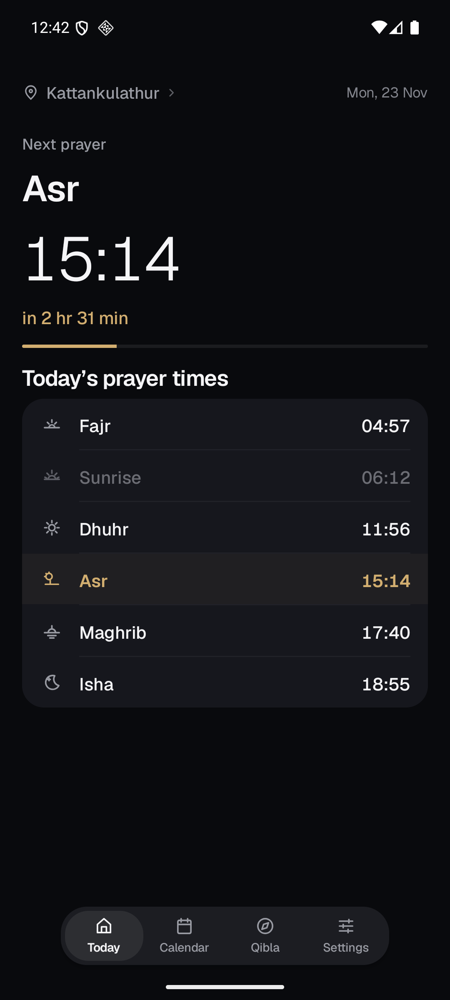
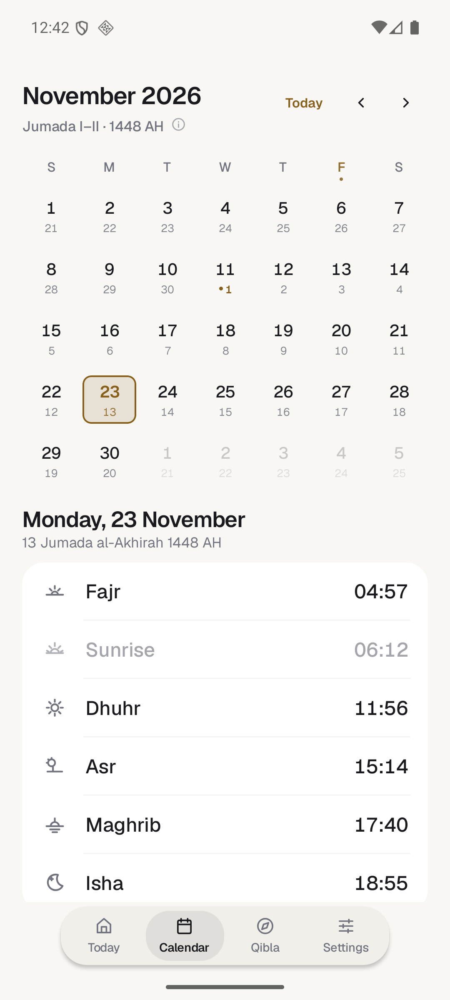
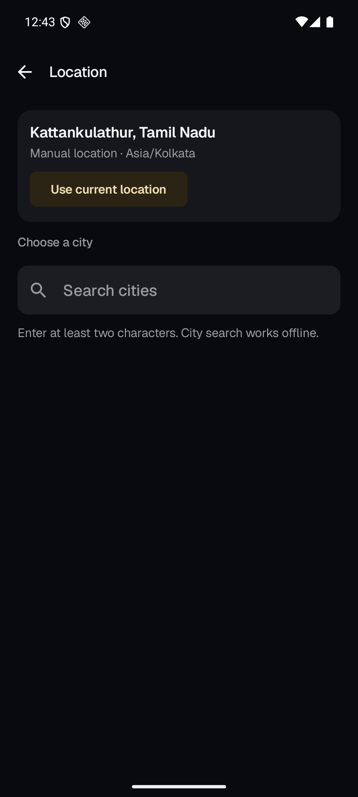

# Salah (صلاة) — Elegant, Privacy-First Islamic Prayer Companion for Android

[](https://www.android.com/)
[-informational)](https://developer.android.com)
[-informational)](https://developer.android.com)
[](#zero-accounts--zero-tracking)
[](#offline-prayer-calculation-engine)

Salah is a free, modern, and completely privacy-respecting native Android application for Islamic prayer times, Hijri calendar schedules, and Qibla direction.

Built from the ground up with **Kotlin** and **Jetpack Compose**, Salah pairs deterministic astronomical calculations with a bespoke **Editorial Luxury** interface designed for clarity, reverence, and daily peace of mind.

---

## Visual Showcase

| Today (Dark Theme) | Today (Light Theme) | Calendar (Dark Theme) | Calendar (Light Theme) |
| :---: | :---: | :---: | :---: |
|  |  |  |  |

| Qibla Compass | Settings (Appearance & Method) | Location Search | Home Screen Widgets |
| :---: | :---: | :---: | :---: |
|  |  |  |  |

---

## Key Features

### 1. Today Prayer Dashboard
- **Hero Countdown:** Live countdown displaying the exact hours, minutes, and seconds remaining until the next prayer.
- **Next Prayer Card:** Highlights the upcoming prayer with time and civil date context.
- **Complete Timetable:** Clear schedules for all six daily markers: **Fajr**, **Sunrise**, **Dhuhr**, **Asr**, **Maghrib**, and **Isha**.
- **Midnight & After-Isha Rollover:** Seamlessly advances to "Tomorrow's Fajr" after Isha without confusing negative countdowns.

### 2. Sensor-Driven Qibla Compass
- **True North & Sensor Fusion:** Computes Kaaba bearing using spherical trigonometry, geomagnetic field measurements, and geomagnetic declination.
- **Haptic Feedback:** Gentle haptic confirmation when device aligns directly with the Qibla.
- **Sensor Calibration Banner:** Warns when device magnetometers require calibration (figure-eight motion) and gracefully handles devices lacking magnetic sensors.

### 3. Hijri & Gregorian Calendar
- **Full Monthly Schedules:** Navigate any past or future month with synchronized Gregorian and Islamic Hijri dates.
- **Date Inspection:** Tap any date to inspect its six prayer timings instantly.
- **Isha Clearance:** Intelligent content padding ensures bottom navigation docks never obscure prayer cards.

### 4. Jetpack Glance Home Screen Widgets
- **2×2 Next Prayer Widget:** Compact glanceable widget featuring next prayer name, time, and live countdown timer.
- **4×2 Daily Timetable Widget:** Expanded widget displaying the entire daily timetable directly on your home screen launcher.

### 5. Calculation Customization
- **Major Calculation Authorities:**
  - University of Islamic Sciences, Karachi
  - Islamic Society of North America (ISNA)
  - Muslim World League (MWL)
  - Umm al-Qura University, Makkah
- **Asr Juristic Conventions:** Standard (Shafi'i, Maliki, Hanbali) and Hanafi shadow ratios.
- **High-Latitude Rules:** Angle-based calculations and midnight rules for polar and sub-polar latitudes.
- **Manual Minute Adjustments:** Fine-tune individual prayer times from −60 to +60 minutes.
- **Time Format:** 12-hour (AM/PM) or 24-hour display toggle.

---

## Zero Accounts & Zero Tracking

Salah is built on strict privacy principles:
- **No Sign-In:** No accounts, passwords, or emails.
- **No Analytics:** Zero tracking SDKs (no Firebase, Google Analytics, Mixpanel, or telemetry).
- **No Ads:** Absolutely zero advertising or monetized data brokers.
- **No Continuous Location:** Automatic location queries GPS **only once in the foreground** when requested.
- **Offline Search:** Search thousands of global cities without granting location permissions.
- **Local Data Only:** Stored in local Room SQLite tables and Android DataStore. Cloud backups are explicitly disabled (`android:allowBackup="false"`).

Read our full [PRIVACY.md](PRIVACY.md) policy.

---

## Offline Prayer Calculation Engine

Salah employs a **dual-engine architecture** for resilient operation anywhere on Earth:
1. **Online Sync:** Connects to the public AlAdhan HTTPS API (`api.aladhan.com`) to fetch monthly tables and caches them locally for 24 hours. The request transmits only selected coordinates and calculation preferences over encrypted HTTPS (IP addresses are processed by network routing and remote hosting infrastructure as standard for internet traffic).
2. **On-Device Astronomical Fallback:** If internet access is unavailable or offline mode is active, the embedded **Batoul Apps Adhan** Kotlin library calculates exact prayer timings directly on your device CPU with zero network transmission.

The application functions 100% reliably in airplane mode, remote locations, and areas with restricted internet access.

---

## System Requirements

- **Operating System:** Android 6.0 (Marshmallow, API level 23) or higher.
- **Target OS:** Android 15 (Vanilla Ice Cream, API level 35).
- **Architecture:** `arm64-v8a`, `armeabi-v7a`, `x86_64`.
- **Sensors:** Accelerometer and magnetometer required for the Qibla compass (prayer times work without sensors).

---

## Installation & Sideloading

Because Salah is distributed directly via GitHub Releases rather than Google Play, you install it via standard Android sideloading:

1. Go to the [Releases](https://github.com/abbasahamed/salah-app/releases) page.
2. Download the latest `Salah-vX.Y.Z-universal.apk`.
3. Open the downloaded APK on your Android device.
4. If prompted with *"Install unknown apps"*, allow your browser or file manager permission to install the application.
5. Tap **Install** and open Salah. No registration or account setup is needed!

---

## Building from Source

### Prerequisites
- JDK 17 or JDK 21
- Android SDK Platform 35 & Build Tools 35.0.0
- Gradle (provided via `./gradlew`)

### Build Commands
```sh
# Clone repository
git clone https://github.com/abbasahamed/salah-app.git
cd salah-app

# Compile and package Debug APK
./gradlew assembleDebug

# Run JVM Unit Tests (255 tests)
./gradlew testDebugUnitTest

# Run Android Lint
./gradlew lintDebug

# Run UI Instrumentation Tests (requires emulator or device)
./gradlew connectedDebugAndroidTest
```

---

## Contributing

We welcome community bug reports, enhancements, and translations! Please read our [CONTRIBUTING.md](CONTRIBUTING.md) guide and [SECURITY.md](SECURITY.md) policy before submitting pull requests.

---

## Known Limitations

- **Compass Sensor Interference:** In environments with strong electromagnetic fields (near laptops, steel structures, or magnetic phone cases), the Qibla compass needle may fluctuate. Wave your phone in a figure-eight pattern to calibrate.
- **Polar Latitudes:** In extreme northern or southern latitudes during summer/winter solstice periods where astronomical twilight or sunrise/sunset does not occur, calculations use high-latitude angle approximations.

---

## License

Salah is open-source software licensed under your choice of either the **Apache License, Version 2.0** or the **MIT License**. See [LICENSE](LICENSE) for terms.
