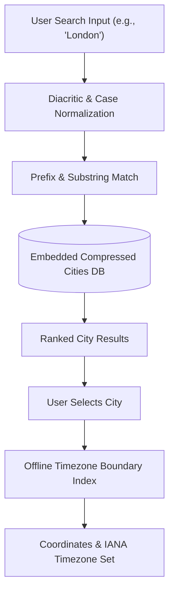

# Location & Privacy Architecture

Salah is engineered to provide precise prayer times and Qibla direction without compromising user privacy.

---

## Privacy Architecture & Guarantees

1. **No Continuous Background Location:** Salah never runs background location tracking services. GPS access is requested only when the user explicitly taps "Current Location" on the Today or Location picker screens.
2. **One-Shot Foreground Acquisition:** Location coordinates are fetched via standard Android `LocationManager` with high accuracy and an immediate timeout. Once obtained, GPS hardware is released immediately.
3. **No Cloud Synchronization:** Selected coordinates and preferences are stored exclusively on the device using AndroidX DataStore. They are never sent to external user databases, analytics pipelines, or cloud services.
4. **HTTPS Encryption for Online Queries:** When online prayer sync is enabled, HTTP queries to AlAdhan transmit coordinates strictly over TLS 1.3 with system CA validation. No advertising IDs, Android IDs, IMEI numbers, or device identifiers are sent.

---

## Offline Location Database

To provide true standalone functionality anywhere in the world, Salah bundles an offline geographic database:

### 1. `cities.tsv.gzip`
- Extracted from [GeoNames](https://www.geonames.org/) for all global cities with populations of 15,000 or greater.
- Includes normalized English names, native script aliases, region/state names, country names, latitude, longitude, and IANA timezone ID.
- Stored as a compressed asset (~2.7 MB) and indexed in an on-device SQLite database on first launch for sub-millisecond prefix searches.

### 2. `timezones.bin.gzip`
- Extracted from [Timezone Boundary Builder](https://github.com/evansiroky/timezone-boundary-builder).
- Contains spatial boundary polygons for all global civil timezones in a compact binary format (~7.4 MB).
- When a user uses GPS without network access, the application performs a point-in-polygon spatial lookup entirely on-device to determine the exact civil timezone, ensuring accurate local prayer schedules even in airplane mode.

