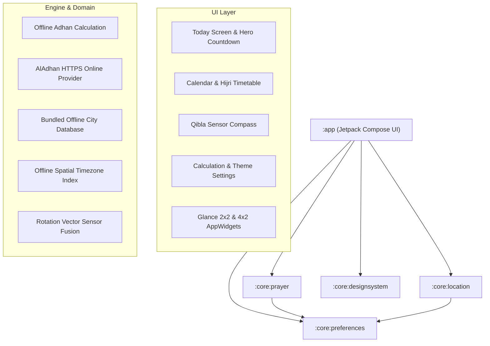

# Salah Architecture Overview

Salah is built with modern native Android architecture principles, utilizing Kotlin, Jetpack Compose, Coroutines, Flow, AndroidX DataStore, and multi-module design.

---

## Modular Structure

The codebase is partitioned into distinct functional modules:

| Module | Responsibility | Key Dependencies |
| :--- | :--- | :--- |
| **`:app`** | Application entry point, UI navigation, ViewModels, Compose screens, and Glance home-screen AppWidgets. | `:core:prayer`, `:core:location`, `:core:preferences`, `:core:designsystem` |
| **`:core:prayer`** | Astronomical prayer-time engine (Adhan Kotlin), HTTPS online sync (AlAdhan API), calculation methods, and juristic adjustments. | Coroutines, kotlinx-serialization, okhttp3 |
| **`:core:location`** | Offline city database search, offline timezone spatial polygon resolution, and foreground GPS provider (`LocationManager`). | SQLite, GZIP decompression, Coroutines |
| **`:core:preferences`** | Type-safe user preference storage (theme, calculation method, Asr convention, high-latitude rule, manual prayer adjustments, selected location). | AndroidX DataStore |
| **`:core:designsystem`** | Shared typography (Geist variable font), theme color definitions (Graphite & Warm Porcelain), and custom vector iconography (`SalahIcons`). | Jetpack Compose Material 3 |

---

## Data Flow & State Management

Salah enforces a strict unidirectional data flow (UDF) pattern:

1. **ViewModels** observe continuous streams from repositories (`PrayerRepository`, `LocationRepository`, `PreferencesRepository`).
2. Repositories emit immutable domain models (`PrayerSchedule`, `LocationItem`, `UserSettings`).
3. ViewModels transform domain state into UI state models (`TodayUiState`, `CalendarUiState`, `QiblaUiState`, `SettingsUiState`) exposed as `StateFlow`.
4. Composables collect state via `collectAsStateWithLifecycle()` and dispatch user actions as typed callbacks back to the ViewModel.
5. No composable performs side-effects, calculations, or network requests directly.

---

## Offline-First Design

All primary features operate without requiring an internet connection:
- **Calculation:** If the device has no network or the online API is unreachable, the application automatically computes identical astronomical prayer times locally using Batoul Apps Adhan.
- **Location:** Users can search and select from over 30,000 global cities stored in the embedded, compressed offline database.
- **Timezone Resolution:** GPS coordinates are converted to valid IANA timezone IDs using an offline spatial index, avoiding remote geocoding services.

