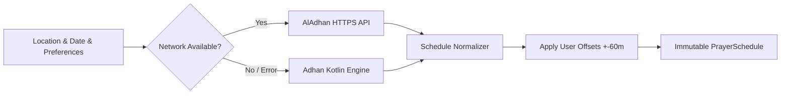

# Prayer Times Architecture & Calculation Engine

Salah employs a **hybrid dual-provider architecture** for calculating Islamic prayer times, combining real-time online synchronization with fully offline astronomical calculation.

---

## 1. Supported Calculation Methods

The prayer calculation engine supports all major international Islamic calculation authorities:

| Method ID | Authority / Standard | Fajr Twilight Angle | Isha Twilight Angle / Offset |
| :--- | :--- | :---: | :---: |
| `KARACHI` | University of Islamic Sciences, Karachi | 18.0° | 18.0° |
| `ISNA` | Islamic Society of North America | 15.0° | 15.0° |
| `MWL` | Muslim World League | 18.0° | 17.0° |
| `MAKKAH` | Umm al-Qura University, Makkah | 18.5° | +90 min after Maghrib (120 min Ramadan) |
| `EGYPT` | Egyptian General Authority of Survey | 19.5° | 17.5° |
| `TEHRAN` | Institute of Geophysics, University of Tehran | 17.7° | 14.0° |
| `GULF` | Gulf Region / UAE Awqaf | 19.5° | +90 min after Maghrib |
| `KUWAIT` | Kuwait Ministry of Awqaf | 18.0° | 17.5° |
| `QATAR` | Qatar Ministry of Awqaf | 18.0° | +90 min after Maghrib |
| `SINGAPORE` | Majlis Ugama Islam Singapura (MUIS) | 20.0° | 18.0° |

---

## 2. Juristic Rules & High-Latitude Adaptations

### Asr Juristic School
- **Standard (Shafi'i, Maliki, Hanbali, Ja'fari):** Shadow length equals object height plus solar noon shadow ($m = 1$).
- **Hanafi:** Shadow length equals twice the object height plus solar noon shadow ($m = 2$).

### High-Latitude Rules
In polar and sub-polar latitudes where twilight does not occur during summer months, Salah supports standard adaptation methods:
- **Middle of the Night:** Twilight duration cannot exceed half the night duration.
- **One-Seventh Rule:** Twilight duration is proportional to one-seventh of the night.
- **Angle-Based:** Twilight duration scales proportionally according to twilight angle ratio.

### User Minute Offsets
Users can configure manual offsets from -60 to +60 minutes for each of the six daily prayers (Fajr, Sunrise, Dhuhr, Asr, Maghrib, Isha) to match their local mosque timetables.

---

## 3. Mathematical Verification & Precision

The offline engine implementation was independently verified against reference calculations (including PrayTime 3.2.0 and AlAdhan astronomical algorithms). Calculations account for:
- Solar declination and equation of time.
- Atmospheric refraction ($0.833^\circ$ at horizon for Sunrise and Sunset).
- Exact local solar noon (Dhuhr) with safety padding.
- Timezone roll-over at local midnight.

