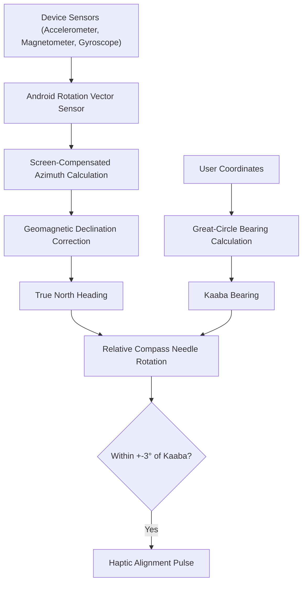

# Qibla Compass & Sensor Fusion Architecture

Salah includes a high-precision, real-time Qibla compass that computes the great-circle bearing to the Kaaba in Mecca from any location on Earth.

---

## 1. Kaaba Bearing Mathematics

The Kaaba in Mecca is located at coordinates:
$$\phi_K = 21.422487^\circ \text{ N}, \quad \lambda_K = 39.826206^\circ \text{ E}$$

For any observer at latitude $\phi$ and longitude $\lambda$, the forward great-circle bearing $\theta$ is calculated using the spherical trigonometry formula:

$$\theta = \text{atan2}\left(\sin(\Delta\lambda) \cos(\phi_K), \; \cos(\phi)\sin(\phi_K) - \sin(\phi)\cos(\phi_K)\cos(\Delta\lambda)\right)$$

where $\Delta\lambda = \lambda_K - \lambda$. The result is normalized to $[0^\circ, 360^\circ)$.

---

## 2. Sensor Fusion & True North Conversion

- **Sensor Type:** The application prioritizes `Sensor.TYPE_ROTATION_VECTOR`, which fuses accelerometer, magnetometer, and gyroscope data internally on the device DSP/sensor hub to eliminate magnetic jitter and gimbal lock.
- **Display Rotation Compensation:** The rotation matrix is remapped according to the current window rotation (`Surface.ROTATION_0`, `ROTATION_90`, etc.) using `SensorManager.remapCoordinateSystem`.
- **True North Declination:** The application calculates magnetic declination using Android's `GeomagneticField` class at the observer's location and altitude, converting magnetic azimuth to True North.
- **Low-Pass Filtering:** Dynamic low-pass damping is applied to orientation angles to provide smooth, natural needle rotation without perceptible latency.

---

## 3. Visual & Interaction Design

- **Upright Kaaba Glyph:** The Kaaba icon on the compass rim remains strictly upright relative to the phone display regardless of needle angle.
- **Haptic Alignment Feedback:** When the user rotates their device to face within $\pm 3^\circ$ of Mecca, a subtle haptic vibration pulse confirms direct alignment.
- **Calibration Guidance:** If device sensors report low accuracy (`SensorManager.SENSOR_STATUS_UNRELIABLE`), an unobtrusive banner instructs the user to perform a figure-eight calibration motion.

