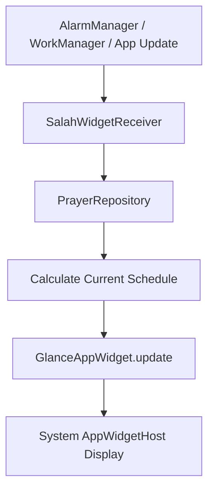

# Android Home Screen Widgets Architecture

Salah provides two modern home-screen widgets built using **Jetpack Glance**, Google's Jetpack Compose-based framework for Android AppWidgets.

---

## 1. Widget Types

| Widget | Dimensions | Content & Features |
| :--- | :---: | :--- |
| **`SalahWidget2x2`** | 2×2 cells | Compact next-prayer hero display: current location, next prayer name, prayer time, and live countdown badge. |
| **`SalahWidget4x2`** | 4×2 cells | Daily timetable display: current location, date, highlighted next prayer, and full 6-prayer schedule table (Fajr to Isha). |

---

## 2. Update Mechanism & Battery Efficiency

- **Glance Declarative Composition:** Widgets are defined in Kotlin using `@Composable` Glance functions with standard modifiers and theme tokens.
- **AlarmManager Scheduling:** The application schedules precise alarms to wake up and update widgets at the exact moment the active prayer transitions (e.g., at Fajr, Sunrise, Dhuhr, Asr, Maghrib, and Isha).
- **Periodic WorkManager Refresh:** A periodic WorkManager task refreshes the timetable at midnight in the active location's civil timezone.
- **Zero Background Polling:** The widgets do not run continuous background threads, polling loops, or active GPS listeners, ensuring negligible battery impact.

