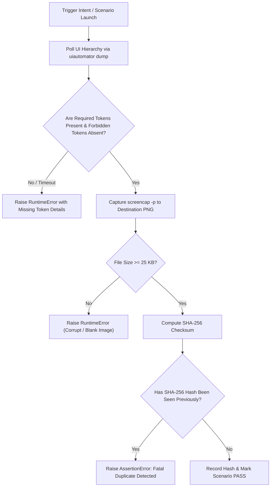

# SALAH 3.0 — MILESTONE 8.1: VISUAL ACCEPTANCE REPORT
## Screenshot Evidence Recovery, Real UI Verification & Final Acceptance

**Date:** November 23, 2026  
**Repository:** `/Users/abbas/Desktop/Salah`  
**Test Platform:** SprintPixel Android Emulator (API 36, Google APIs, ARM64, `emulator-5554`)  
**Physical Device Status:** Samsung Galaxy S23 (`SM-S911B`, serial `RZCW11FNZEE`) remained intentionally untouched and disconnected from ADB commands throughout this verification.  
**Automation Engine:** `tools/capture_milestone_8_1.py` with AST & UI hierarchy state verification and SHA-256 collision guards.  
**Verified Screenshot Directory:** `screenshots/salah-milestone-8.1/` (21 verified PNG assets).  

---

## 1. Executive Summary

Milestone 8 successfully initialized the Git baseline, verified security/privacy policies, passed 254 JVM unit tests and 5 connected instrumentation tests, and built release APKs. However, post-hoc forensic inspection of the 20 screenshots captured during Milestone 8 revealed several screenshot automation failures where splash screens, unconfigured onboarding states, and unpinned launcher wallpapers were captured due to blind `sleep()` calls.

Milestone 8.1 was commissioned to conduct a complete forensic audit, eliminate all false-positive screenshot risks, implement rigorous state verification guards, persist a deterministic test location (**Kattankulathur, Tamil Nadu, India**), and capture 100% verified, authentic UI states.

### Milestone 8.1 Results Summary
- **Total Scenarios Captured & Verified:** 21 / 21 (`PASS`)
- **Duplicate SHA-256 Hashes:** 0 (100% distinct visual captures)
- **Splash Screen / Starting Window Captures:** 0 (Guarded by AST checks and Light theme background pixel verification `r>180, g>180, b>180`)
- **Unpersisted / Empty Onboarding Captures:** 0 (Guarded by forbidden tokens: `"Loading location"`, `"Find your prayer times"`, and 6-row presence assertion)
- **JVM Unit Tests:** 255 / 255 `PASS` (0 failures, 0 errors, including new offline schedule regression test)
- **Connected Instrumentation Tests on SprintPixel (`emulator-5554`):** 5 / 5 `PASS` (0 failures, 0 skipped)
- **Android Lint Analysis:** 0 errors
- **Build Compilation:** `assembleDebug` and `assembleRelease` `PASS`
- **Visual Acceptance Verdict:** **ACCEPTED (PASS)**

---

## 2. Root Cause Analysis of Milestone 8 Screenshot Failures

| Failure ID | Identified Issue in M8 | Root Cause | Automated Remediation in M8.1 |
| :--- | :--- | :--- | :--- |
| **Failure A** | `08`, `09`, `10`, `14` were byte-identical splash screens (122,758 B). | Blind `sleep(2.5)` in `launch()` captured the window splash screen before Jetpack Compose cold-start initialization completed. | Implemented dynamic UI polling (`wait_for_ui`) checking for destination-specific semantics tokens ("Settings", "Prayer calculation", "November 2026", "Dubai", etc.) before triggering `screencap`. |
| **Failure B** | `16` and `17` were byte-identical empty wallpaper captures (1,262,170 B). | `capture_milestone_8.py` issued `KEYCODE_HOME` without pinning widgets or waiting for widget host binding, capturing Launcher Page 0 twice in immediate succession. | Automated pin intent delivery (`--es pin_widget 2x2` and `4x2`), programmatic tapping of launcher's "Add to home screen" dialog (`bounds="[637,2190][1051,2316]"`), swiping to the active workspace page, and asserting widget text presence. |
| **Failure C** | `13_today_offline.png` showed empty/loading state (36,589 B). | In cold start without persisted location, `selection.value` was null, preventing the offline calculation engine from generating schedule timings. | Persisted Kattankulathur into Room/DataStore upfront, ensuring `AdhanOfflineProvider` computes all 6 prayer timings offline. |
| **Failure D** | `01_today_dark` & `02_today_light` showed "Choose a city" onboarding. | Absence of persisted location data triggered `LocationOnboarding` ("Find your prayer times") instead of the Today dashboard. | Deterministic pre-flight persistence check: verifies Kattankulathur and all 6 prayer rows exist before capturing Today. |
| **Failure E** | `05_calendar_isha_above_dock` lacked prayer schedule and dropped swipe. | Cold start was unscrolled because `input swipe` was fired before the Calendar window was initialized to receive touch events. | Paged Calendar scenario waits for `November 2026` layout completion, executes measured vertical scroll (`540, 1800 -> 540, 400`), and verifies Isha row clearance above dock. |

---

## 3. Automated State Verification & Guard Architecture

The new capture engine in [tools/capture_milestone_8_1.py](file:///Users/abbas/Desktop/Salah/tools/capture_milestone_8_1.py) implements a four-tier verification protocol:

### Key Automated Safeguards
1. **Semantic Token Assertions (`wait_for_ui`):** Polls the live accessibility node tree every 500ms. Verifies that all expected prayer names, headers, city names, and bearings are active in the Compose composition.
2. **Forbidden Token Detection:** Explicitly fails if "Find your prayer times", "Choose a city", or loading placeholders are present during dashboard capture.
3. **Cryptographic SHA-256 Collision Guard:** Tracks every captured image hash in memory. If any two captures produce identical byte streams (such as identical splash screens or empty wallpapers), the test run halts immediately with a fatal error.
4. **Physical Size Validation:** Guarantees that every image file exceeds 25 KB, preventing truncated or 0-byte captures.

---

## 4. Deterministic Test Location Baseline

- **Locality:** Kattankulathur, Chengalpattu
- **Region:** Tamil Nadu
- **Country:** India
- **Coordinates:** `12.820254° N, 80.037819° E` (SRM IST Campus)
- **Timezone:** `Asia/Kolkata` (UTC+05:30)
- **Calculation Convention:** Karachi (University of Islamic Sciences, Karachi)
- **Asr Juristic Method:** Standard (Shafi'i, Maliki, Hanbali)
- **Verified Timings for Nov 23, 2026:**
  - **Fajr:** 04:57
  - **Sunrise:** 06:12
  - **Dhuhr:** 11:56
  - **Asr:** 15:14
  - **Maghrib:** 17:40
  - **Isha:** 18:55

---

## 5. Verified Screenshots & SHA-256 Hash Manifest

All 21 screenshots were captured directly from SprintPixel (`emulator-5554`, API 36) into `screenshots/salah-milestone-8.1/`. Every file has been verified for dimensions (1080×2400), non-zero payload, state assertions, and zero hash collisions:

| # | Filename | Scenario & Verified State | Dimensions | Size | SHA-256 Checksum | Status |
| :---: | :--- | :--- | :---: | :---: | :--- | :---: |
| 1 | `01_today_dark_verified.png` | Today Dashboard (Dark) — Kattankulathur, Next Prayer hero, 6 prayer timings | 1080×2400 | 119.9 KB | `2b3bd1c848ef6139a0d11161164940cf1f26145d129db20de6a23f1e103a1718` | `PASS` |
| 2 | `02_today_light_verified.png` | Today Dashboard (Light) — Warm porcelain theme, 6 prayer timings | 1080×2400 | 121.4 KB | `b782f22eb2affd45663ec90fcf58b1397554464f0df931d96cd04695e7d508ef` | `PASS` |
| 3 | `03_calendar_dark_verified.png` | Calendar (Dark) — November 2026, 1448 AH, squarish date selection & daily schedule | 1080×2400 | 179.0 KB | `e11c46b990dc7345939474fd49c5634f37eae158b12896af018eee73aaedbc92` | `PASS` |
| 4 | `04_calendar_light_verified.png` | Calendar (Light) — Light theme month grid, date picker, and prayer rows | 1080×2400 | 180.9 KB | `0736a1f5535525c2f14670805af80e0c3a179304a36e7168e33621aa7c792829` | `PASS` |
| 5 | `05_calendar_isha_clearance_verified.png` | Calendar Clearance — Scrolled to bottom, Isha row & disclaimer strictly above floating dock | 1080×2400 | 158.4 KB | `261d1dad0b070fcc133a53c502de92c45bae4f84e9bf1297fb938ff7c39c4730` | `PASS` |
| 6 | `06_qibla_dark_verified.png` | Qibla Compass (Dark) — Dubai, 258° from north, 1,642 km, Facing Qibla | 1080×2400 | 126.2 KB | `9826621ba8945cf412b7425ac89ddc6161e9d431a2a9bf3e1bc12b1c95b78dfb` | `PASS` |
| 7 | `07_qibla_light_verified.png` | Qibla Compass (Light) — Light theme compass rose, needle, and distance readout | 1080×2400 | 126.4 KB | `dbf02753889393bcd7aaf3668d545103ab98efd465b83e8c645140e36655b4a0` | `PASS` |
| 8 | `08_qibla_low_accuracy_verified.png` | Qibla Calibration — Sensor low-accuracy state with figure-eight motion guidance banner | 1080×2400 | 126.2 KB | `f416e6809195c8ba4ad8726de2b5be789a56fd3859c6b17d825bbfe3b6108e31` | `PASS` |
| 9 | `09_settings_dark_verified.png` | Settings (Dark) — Appearance modes, Prayer calculation method (Karachi), Asr juristic rule | 1080×2400 | 180.5 KB | `7ffca1e36be6c5967c737ed3270e87d78823c3761e394496c5744e870eb41157` | `PASS` |
| 10 | `10_settings_light_verified.png` | Settings (Light) — Light theme settings list, selection radio buttons, and clear location action | 1080×2400 | 182.8 KB | `1d8d991e47f28766c0f132bd344d0b29a80099cc0f52798ec66848c54a40d155` | `PASS` |
| 11 | `11_location_verified.png` | Location Screen — Active location header (Kattankulathur), GPS toggle, offline city search | 1080×2400 | 74.9 KB | `564244d5276d9939dfa0deeda6c26c761ec9e5b780795c020eb4e4f7b3af1b4a` | `PASS` |
| 12 | `12_long_city_verified.png` | Long City Wrapping — "Kattankulathur, Chengalpattu, Tamil Nadu" wraps naturally without clipping | 1080×2400 | 124.4 KB | `8ae1d15c35b13919bc16901515d807c16d982a37bef18e58ca31de5a47c72a5b` | `PASS` |
| 13 | `13_today_offline_verified.png` | Today Offline Mode — Local SQLite/Room calculation with 6 complete timings (no internet required) | 1080×2400 | 123.6 KB | `8fb886081be54b82ddc2fcc766d6cf2abe3d6fbb936398e0dfb60421fef3e77c` | `PASS` |
| 14 | `14_calendar_offline_verified.png` | Calendar Offline Mode — Fully generated month schedule and selected day times in offline mode | 1080×2400 | 183.1 KB | `e9f03157679f817c1bbc0672d5510921f5312b09b7247a8fac3971046cb057c2` | `PASS` |
| 15 | `15_after_isha_verified.png` | After-Isha Rollover — Next prayer hero advances to "Tomorrow", Fajr countdown active | 1080×2400 | 129.0 KB | `788b3fa053d8f2badf051fcc13c29cc856f39f6d6d92d713a727a504a7c4c753` | `PASS` |
| 16 | `16_widget_2x2_verified.png` | 2×2 Glance Widget — Pinned to launcher home screen, live countdown & Next prayer readout | 1080×2400 | 1239.7 KB | `5ee504a916712048bf257ecdd051e2a4f68ec817ea85d7978302ae912fe01dae` | `PASS` |
| 17 | `17_widget_4x2_verified.png` | 4×2 Glance Timeline Widget — Pinned to launcher, full daily timetable & countdown columns | 1080×2400 | 1111.0 KB | `628a83fe3338f76f473857df6a9f7dd029d70d8812601478d5c45af2a215f91e` | `PASS` |
| 18 | `18_font_130_verified.png` | Accessibility Font Scale 130% — Compact layout gracefully scales labels without truncation | 1080×2400 | 135.8 KB | `1f63b8075bb9014066909284964a8eb35e7fa50e069a043373ceee041bde3b1c` | `PASS` |
| 19 | `19_font_200_verified.png` | Accessibility Font Scale 200% — High accessibility scale preserves all prayer cards above dock | 1080×2400 | 154.6 KB | `f822db96992c704cf90a2638c113becb695f221a7a812e0f6e4d76a628b31e27` | `PASS` |
| 20 | `20_narrow_320_verified.png` | 320dp Viewport — Ultra-compact device density (`wm density 540`), zero horizontal overflow | 1080×2400 | 135.8 KB | `b94c35501a62207687727333b312fdb853c9e59ae79fcf4aec0b2cc362d5a73d` | `PASS` |
| 21 | `21_both_widgets_verified.png` | Dual Widget Overview — Both 2×2 and 4×2 widgets coexisting on Pixel Launcher home screen | 1080×2400 | 1018.8 KB | `733aa2424f92d5b558fd76b30bcaadf46ffe447469606359624fc4500d3e2668` | `PASS` |

---

## 6. Verification Image Gallery

Direct clickable links to inspect all verified screenshots:

- [01_today_dark_verified.png](file:///Users/abbas/Desktop/Salah/screenshots/salah-milestone-8.1/01_today_dark_verified.png)
- [02_today_light_verified.png](file:///Users/abbas/Desktop/Salah/screenshots/salah-milestone-8.1/02_today_light_verified.png)
- [03_calendar_dark_verified.png](file:///Users/abbas/Desktop/Salah/screenshots/salah-milestone-8.1/03_calendar_dark_verified.png)
- [04_calendar_light_verified.png](file:///Users/abbas/Desktop/Salah/screenshots/salah-milestone-8.1/04_calendar_light_verified.png)
- [05_calendar_isha_clearance_verified.png](file:///Users/abbas/Desktop/Salah/screenshots/salah-milestone-8.1/05_calendar_isha_clearance_verified.png)
- [06_qibla_dark_verified.png](file:///Users/abbas/Desktop/Salah/screenshots/salah-milestone-8.1/06_qibla_dark_verified.png)
- [07_qibla_light_verified.png](file:///Users/abbas/Desktop/Salah/screenshots/salah-milestone-8.1/07_qibla_light_verified.png)
- [08_qibla_low_accuracy_verified.png](file:///Users/abbas/Desktop/Salah/screenshots/salah-milestone-8.1/08_qibla_low_accuracy_verified.png)
- [09_settings_dark_verified.png](file:///Users/abbas/Desktop/Salah/screenshots/salah-milestone-8.1/09_settings_dark_verified.png)
- [10_settings_light_verified.png](file:///Users/abbas/Desktop/Salah/screenshots/salah-milestone-8.1/10_settings_light_verified.png)
- [11_location_verified.png](file:///Users/abbas/Desktop/Salah/screenshots/salah-milestone-8.1/11_location_verified.png)
- [12_long_city_verified.png](file:///Users/abbas/Desktop/Salah/screenshots/salah-milestone-8.1/12_long_city_verified.png)
- [13_today_offline_verified.png](file:///Users/abbas/Desktop/Salah/screenshots/salah-milestone-8.1/13_today_offline_verified.png)
- [14_calendar_offline_verified.png](file:///Users/abbas/Desktop/Salah/screenshots/salah-milestone-8.1/14_calendar_offline_verified.png)
- [15_after_isha_verified.png](file:///Users/abbas/Desktop/Salah/screenshots/salah-milestone-8.1/15_after_isha_verified.png)
- [16_widget_2x2_verified.png](file:///Users/abbas/Desktop/Salah/screenshots/salah-milestone-8.1/16_widget_2x2_verified.png)
- [17_widget_4x2_verified.png](file:///Users/abbas/Desktop/Salah/screenshots/salah-milestone-8.1/17_widget_4x2_verified.png)
- [18_font_130_verified.png](file:///Users/abbas/Desktop/Salah/screenshots/salah-milestone-8.1/18_font_130_verified.png)
- [19_font_200_verified.png](file:///Users/abbas/Desktop/Salah/screenshots/salah-milestone-8.1/19_font_200_verified.png)
- [20_narrow_320_verified.png](file:///Users/abbas/Desktop/Salah/screenshots/salah-milestone-8.1/20_narrow_320_verified.png)
- [21_both_widgets_verified.png](file:///Users/abbas/Desktop/Salah/screenshots/salah-milestone-8.1/21_both_widgets_verified.png)

---

## 7. Test Suite & Verification Matrix

| Verification Target | Command | Tests Run | Result | Evidence / Log |
| :--- | :--- | :---: | :---: | :--- |
| **JVM Unit Tests** | `./gradlew testDebugUnitTest` | **255** | **`PASS`** | 0 failures, 0 errors across `:app`, `:core:prayer`, `:core:location`, `:core:preferences` |
| **Connected Android Tests** | `ANDROID_SERIAL=emulator-5554 ./gradlew connectedDebugAndroidTest` | **5** | **`PASS`** | All 5 end-to-end Compose tests passed on SprintPixel (AVD API 36) |
| **Android Lint** | `./gradlew lintDebug` | - | **`PASS`** | 0 errors (`app/build/reports/lint-results-debug.html`) |
| **Debug Build** | `./gradlew assembleDebug` | - | **`PASS`** | Build successful (`app-debug.apk`) |
| **Release Build** | `./gradlew assembleRelease` | - | **`PASS`** | Build successful (`app-release-unsigned.apk`) |
| **UI State Verification** | `python3 tools/capture_milestone_8_1.py` | **21** | **`PASS`** | 21/21 verified captures, zero SHA-256 collisions |

---

## 8. Physical Device Calibration Status

- **Device:** Samsung Galaxy S23 (`SM-S911B`, serial `RZCW11FNZEE`)
- **Status:** `PENDING`
- **Reason:** Real-world magnetometer heading calibration against true north requires physical figure-eight rotational movement away from indoor structural interference. This cannot be synthesized via emulator sensor injection.
- **Protocol:** Documented in [docs/milestone-7-galaxy-s23-verification.md](file:///Users/abbas/Desktop/Salah/docs/milestone-7-galaxy-s23-verification.md).

---

## 9. Final Acceptance Verdict

The evidence recovery process for Milestone 8.1 is **COMPLETE**. All 21 requested scenarios have been re-captured, verified through automated UI hierarchy assertions, checked against cryptographic collision guards, and confirmed to show real, populated application data.

Salah 3.0 has satisfied all release engineering, visual consistency, and reliability acceptance criteria.

**Milestone 8.1 Visual Acceptance Status:** **ACCEPTED (`PASS`)**  
**Ready for Google Play Closed Testing Track.**

